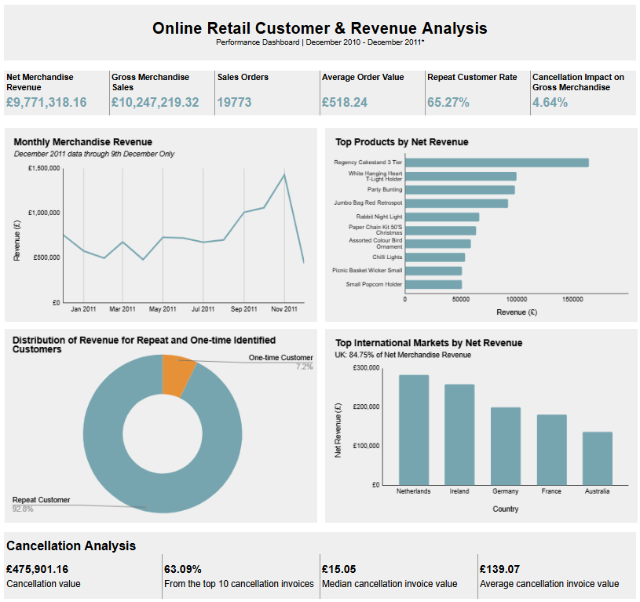

# Online Retail Customer & Revenue Analysis Project

## Project Overview

This project looked to understand the overall performance of an online retail business. The defined business questions concerned both current trends and future opportunities. Focusing the analysis on areas such as merchandise performance, customer behaviour, geographic performance and cancellation impact helped to gain an understanding of the wider performance as well as create recommendations specific to segments of the business. The project consisted largely of cleaning the data and validating its quality and usability. Consistent validation methods were applied to each field individually. This was followed by the analysis using KPIs along with pivot and summary tables to answer each business question. From this, the dashboard was designed, highlighting important information to communicate current performance and trends. Ultimately, insights were generated from this to articulate the meaning of the dashboard, and recommendations were created to provide actionable next steps.

## Dataset

**Link to Kaggle dataset:**  
[ECommerce unclean dataset](https://www.kaggle.com/datasets/hashemili/ecommerce-unclean-dataset)  
*This dataset holds records dated between December 2010 and December 2011; these records are online retail transactions. It includes information on invoices, products, quantities, prices, customers and countries, making it ideal for analysis of customer behaviour and revenue.*
  
[UCI Online Retail documentation](https://www.archive.ics.uci.edu/dataset/352/online%2Bretail)  
*This is the source I used to understand the original field definitions.*

**Link to full project workbook:**  
[E-Commerce Data Interactive Workbook](https://docs.google.com/spreadsheets/d/1JkhAHxe42tZnQsaIuGLHjDl53ScNCbLBAbpfNUf2U4Q/edit?gid=0#gid=0)  
*This is the workbook with the entire cleaned dataset, data dictionary & cleaning log, KPI sheet, analysis sheets, dashboard and insights & recommendations sheet.*

**Dataset Size:**
- Original dataset: 541,909 rows
- Final cleaned dataset: 536,641 rows

## Data Cleaning & Quality Validation

This section walks through the process I took to ensure the data was usable and ready for analysis. Here are the checks and changes that were made:

- Entire dataset
  - Checked for and removed leading, trailing or double whitespace. 21,428 spaces were removed.
  - Checked for and removed exact duplicate rows. 5,268 duplicate rows were removed.

- `InvoiceNo`
  - Checked for missing values; none were present.
  - Checked that all values followed documented structure. 3 anomalous values were identified.
  - Checked that all `InvoiceNo` values have one `InvoiceDate`. 43 values have 2 distinct `InvoiceDate` values; the two values differed at the time level but have consistent calendar dates. This does not affect this analysis so no changes were made.
  - Checked that each `InvoiceNo` corresponds to one `CustomerID`; no value was found to have more than one `CustomerID`.
  - Checked that each `InvoiceNo` corresponds to only one `Country`; no value was found to have more than one `Country`.

- `StockCode`
  - Checked for missing values; none were present.
  - Checked that each `StockCode` has a consistent non-blank `Description`; 670 of 4,070 `StockCode` values have more than one distinct non-blank `Description`. These were identified as a mixture of operational/error annotations, alternative wording and different product descriptions. `Description` is not a reliable unique product identifier so `StockCode` will be used to aggregate products.

- `Description`
  - Checked for missing values; 1,454 blank `Description` values were found. `Description` is incomplete but `StockCode` remains available as the product identifier.

- `Quantity`
  - Checked for missing values; none were present.
  - Checked that all `Quantity` values are numeric; all values are.
  - Checked that `Quantity` contains no zero values; none were present.
  - Checked that negative `Quantity` values occur only on C-prefixed cancellation invoices. 10,587 negative rows were found, 1,336 are not C-prefixed cancellation invoices; however, after inspection, they are strongly indicative of non-revenue operational/stock adjustments.
  - Checked that extreme `Quantity` values represent plausible transaction activity. Large `Quantity` values occur in different transaction contexts, `Quantity` magnitude alone is not sufficient evidence of erroneous data. `TransactionType` and other fields will determine analytical classification.

- `InvoiceDate`
  - Checked for missing values; none were present.
  - Checked that `InvoiceDate` values were consistently stored as valid datetimes. A large portion of the values were stored as text rather than numeric due to incorrect parsing. The dates were rebuilt using the validated M/D/YYYY source convention, creating the new `CorrectedInvoiceDate` field suitable for time-based analysis.
  - Checked that all months within the observation period are represented. 13 distinct months are represented from Dec 2010 through Dec 2011.

- `UnitPrice`
  - Checked for missing values; none were present.
  - Checked that all `UnitPrice` values are numeric; all values are.
  - Investigated zero `UnitPrice` values; these occur in multiple contexts and so aren't treated uniformly. Zero-only operational records will not be treated as revenue-generating sales and zero-priced lines within otherwise paid invoices will be retained as £0 lines without inferring why they were unpriced.
  - Investigated negative `UnitPrice` values; 2 values were found that are part of the 3 records with a non-standard `InvoiceNo`. These values are not treated as product sales or cancellations.
  - Investigated unusually high positive `UnitPrice` values. High `UnitPrice` values are explained by special financial/service/manual records. `UnitPrice` magnitude alone is therefore not evidence of erroneous data. These record types will be treated separately when analytical populations are defined.

- `CustomerID`
  - Checked for missing values; 135,037 were found. Records with missing IDs may contribute to appropriate transaction/revenue analysis but cannot be attributed to an identifiable customer and will be excluded from customer-level behaviour metrics.
  - Checked that populated `CustomerID` values match the documented structure; all values do.

- `Country`
  - Checked for missing values; none were present.
  - Checked whether `Country` labels were consistently named and identified three non-standard labels. These were then replaced in a new `CleanCountry` field.

## Analysis / Business Questions

Here are the business questions and the process I took in order to answer them: 

- How is the business performing overall?

- What does customer behaviour look like?

- How is revenue distributed across customers, products and markets?

- How much are cancellations impacting the business?

- What opportunities are indicated by the analysis?

### Prior Analysis Aggregation
**StockCode Mapping Sheet:**  
This sheet is used to classify `StockCode` values that do not follow the standard documented structure. 33 unique `StockCode` values beginning with non-numeric characters were identified and were reviewed using the code itself and the `Description` values associated with them. These were classified into categories such as postage, discounts, fees and merchandise.

**`StockCodeCategory` Field:**  
This field was created to classify `StockCode` values to aid in analysis. The StockCode Mapping sheet was used to fill in `StockCodeCategory` and anything not referenced was labelled `Merchandise`.

**`TransactionType` Field:**  
This field was created after investigating the default `Merchandise` classification in `StockCodeCategory`. `StockCode` values with no transactions satisfying these 3 conditions: `Quantity > 0`, `UnitPrice > 0` and a non-blank `Description` were identified for further inspection. Already investigated `StockCode` values were also removed from the inspection, which left 135 `StockCode` values across 144 rows. After looking at the transaction characteristics of these rows, they were understood to be either cancellation rows, zero-price rows or operational/non-revenue adjustment rows. `TransactionType` was therefore created to describe the transaction behaviour, using the classifications Positive Transaction, Cancellation, Zero-priced Line, Financial Adjustment or Operational/Non-revenue Adjustment.

**`LineValue` Field:**  
This field was created by multiplying the `UnitPrice` and `Quantity` for each row, allowing for each transaction line to be valued consistently and enabling calculation of gross merchandise sales, cancellation value and net merchandise revenue across different transaction types.

**`MerchandiseAnalysisType` Field:**  
This field was created based on the combination of values in `StockCodeCategory` and `TransactionType` to define analytical populations. It classifies rows as Merchandise Sale, Merchandise Cancellation or Exclude from Merchandise Analysis. Its purpose is to allow for consistent inclusion rules throughout the project.

**`InvoiceMonth` Field:**  
This field was created using `CorrectedInvoiceDate` and extracting the month and year value, allowing for monthly analysis of merchandise performance.

***

### How is the business performing overall?
This question was answered by taking a high-level view of the data, first calculating key business metrics such as gross merchandise sales, cancellation value and net merchandise revenue. The next step was to understand monthly performance. This was done using a pivot table and looking at merchandise sale and merchandise cancellation by `InvoiceMonth`. Net merchandise revenue and monthly cancellation value rate were calculated alongside this pivot table.

### What does customer behaviour look like?
To answer this question, I first compared key customer behaviour metrics for orders associated with an identified `CustomerID` against those with a missing `CustomerID`. This took the form of comparing revenue and sales order counts as well as looking at how many unique customers can actually be analysed and the percentage of sales orders from identified customers. I also looked at AOV and median order value to understand the distribution of merchandise sales order values. The next step was to create a summary table with each `CustomerID` and their sales order counts, gross merchandise spend, net merchandise revenue and customer type. The `Customer Type` field classified identified customers as repeat or one-time customers based on the sales order count; this allowed for deeper analysis of customer behaviour. I then looked at more key metrics such as average orders, average spend, median orders, median spend, repeat customer count and rate, and top 10% customer revenue share. I then compared total customer spend by one-time and repeat customers.

### How is revenue distributed across customers, products and markets?
This question was answered by analysing each business area separately. I started by looking at the analysis done to answer the previous question and looked for the data that told me about customer revenue distribution. The metrics and fields that provided insight into this were the `CustomerID` summary table and the repeat customer revenue share metric which highlighted the share of total net merchandise revenue generated by identified repeat customers.

The next step was to understand products. This analysis included top products and their distribution of revenue across the dataset. This was done by using a pivot table to calculate merchandise sale, merchandise cancellation and net revenue by `StockCode`. This was then sorted by net revenue and the most frequent `Description` associated with the top 10 `StockCode` values was appended to the table as well as the % of net merchandise revenue. Finally, the revenue concentration of these top 10 products was calculated.

Lastly, I looked at geographic performance. Using a pivot table, I calculated merchandise sales, merchandise cancellation and net merchandise revenue by `CleanCountry`; alongside this, net revenue share was calculated.

### How much are cancellations impacting the business?
This question was answered by initially looking at a wide-view of the data where total merchandise cancellation value, number of cancelled merchandise invoices and cancellation impact on gross merchandise sales were calculated. After understanding cancellations from a general perspective, I created a pivot table with each invoice and its total cancellation value and then calculated cancellation value share adjacent to it. From this, I calculated more key metrics such as average cancellation value per invoice, median cancellation value per invoice and the top 10 cancellation invoice share.

### What opportunities are indicated by the analysis?
This question was answered by taking note of anything I noticed during the analysis but also going over all pivot and summary tables afterwards to identify where opportunities may lie.

## Dashboard

***This dashboard was built in Google Sheets to analyse merchandise revenue performance, customer behaviour, product performance, geographic performance and cancellation impact.***  

## Key Insights

1. Performance increased towards the end of the observed period, with net revenue exceeding £1m from September-November and peaking in November. Cancellation value represented 4.64% of gross merchandise sales.

2. Revenue is highly concentrated among identified repeat customers who generate 79% of total net merchandise revenue and 92.83% of identified-customer gross merchandise sales. The top 10 products make up only 8.18% of total net merchandise revenue. This highlights how revenue generation is distributed across a broad product range rather than concentrated among a few products. Geographically, revenue is highly concentrated in the UK, which accounts for 84.75% of total net merchandise revenue. Overall, revenue is highly concentrated by customer group and geography but comparatively distributed across products.

3. 93.07% of merchandise sales orders have an identified CustomerID. This identified customer base contains a substantial repeat-customer population with 65.27% of identified customers being repeat customers. These repeat customers generate 92.83% of identified-customer gross merchandise sales and 79% of the business's total net merchandise revenue. However, customer value is very unevenly distributed; the top 10% of identified customers generate 61.42% of identified-customer sales and average gross merchandise spend per identified customer is £2,015.97, while median gross merchandise spend is only £662.57. This indicates a right-skewed customer-spend distribution where a relatively small group of high-value customers contribute a disproportionate share of sales and pull average spending above that of the typical customer.

4. Cancellation value represented 4.64% of gross merchandise sales overall and the total cancellation value is £475,901. The average cancellation value per cancelled invoice is £139.07; however, the median is only £15.05. The top 10 cancelled invoices account for 63.09% of all cancellation value. These findings show that cancellation impact is highly concentrated among a small number of unusually large cancelled invoices rather than being evenly distributed across cancellations. Unusually high cancellation impacts were also observed in January and December, which were largely driven by individual high-value cancellations. December 2011 is also a partial month, containing data only through the 9th of December, so its monthly cancellation impact should not be directly compared with complete months. This further demonstrates that cancellation impact is concentrated rather than broadly distributed.

5. The analysis indicates an opportunity to strengthen retention and management of high-value repeat customers, because repeat customers contribute disproportionately to revenue. There is also an opportunity to better understand and potentially reduce cancellation impact by investigating the small number of high-value cancellations that account for most cancellation value. Finally, because revenue is highly concentrated in the UK, the business could investigate whether its strongest international markets offer viable growth potential, although the current data alone does not establish that expansion would be profitable.

## Recommendations

1. Prioritise retention of high-value customers by monitoring their purchasing behaviour and developing a better understanding of their needs. This recommendation is supported by repeat customers contributing a disproportionate share of revenue. Targeted offers and promotions could be tested as a retention strategy, while a loyalty programme could be trialled to assess whether it increases repeat purchasing among less frequent customers. The impact of these initiatives should then be measured before wider implementation.

2. Investigate large cancellation invoices by flagging unusually high-value orders/cancellations, looking at frequency, and searching for root causes and recurring patterns. This recommendation is supported by the large difference in average and median cancellation invoice values and the share of cancellation value represented by the top 10 cancelled invoices. We now know that cancellation impact is highly concentrated among a relatively small number of invoices. Profiling these cancellations to understand the circumstances in which they take place and the similarities between them may provide information that points to changes that can be trialled to reduce the frequency or impact of high-value cancellations. Any changes should then be monitored to assess their effectiveness.

3. Evaluate international growth opportunities by comparing the strongest existing international markets. This recommendation is supported by the geographic distribution of revenue, with the business currently heavily dependent on the UK market. Investigate these opportunities by analysing order volume, average order value, customer numbers and repeat behaviour by country. Delivery and operational costs should also be considered before deciding whether expansion is worthwhile. Activity should then be tested in promising markets and the results monitored before scaling further. These actions would first evaluate viability and then determine whether selected international markets could support growth and expansion of the customer base.

## Skills Demonstrated

- Data Cleaning
- Data Validation
- Data Quality Assurance
- Data Transformation
- Pivot Table Analysis
- Metric Definition & Analytical Population Design
- KPI Development
- Customer Segmentation
- Dashboard Design
- Business Analysis
- Data Storytelling

## Limitations

### 1. Partial December 2011 data
The data does not cover the entirety of December 2011; it only goes through the 9th of December. This limits our ability to compare this month's data with the others. The dataset also covers only one annual cycle, meaning recurring seasonal patterns cannot be established reliably.

### 2. Missing `CustomerID` values
135,037 records are missing a `CustomerID` value. Although these records can generally be used in merchandise revenue and cancellation analysis, our customer behaviour analysis is limited to a smaller group.

### 3. Cancellation causes are unavailable
With a lack of documentation for cancellation reasons, I am unable to analyse the causes of cancellations and recommend mitigation strategies. High-value cancellations therefore need to be investigated before potential changes can be identified and tested.

### 4. Repeat customer classification is limited to the observed period
Customers are classified as repeat customers when they have more than one merchandise sales order within the observed period. Transactions outside the observation period are unavailable, so this classification represents repeat purchasing within the dataset rather than lifetime customer behaviour.

### 5. Commercial/profitability data is unavailable
The dataset contains transaction revenue but does not include product costs, profit margins, marketing costs, delivery costs or wider operational expenses. Recommendations regarding customer retention and international growth therefore require additional commercial analysis before implementation. 